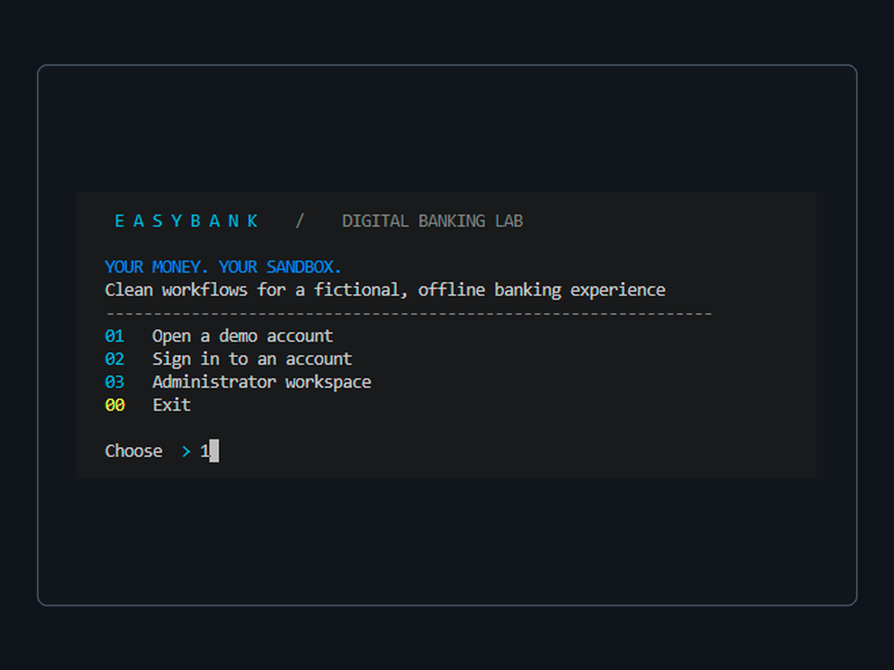
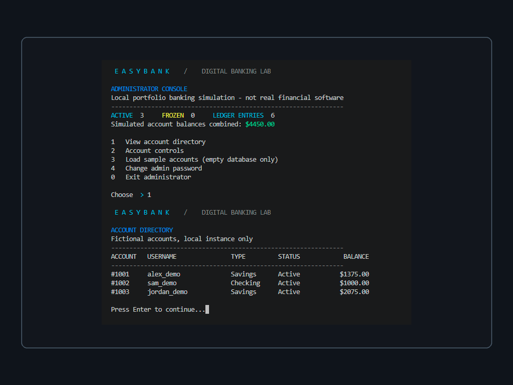
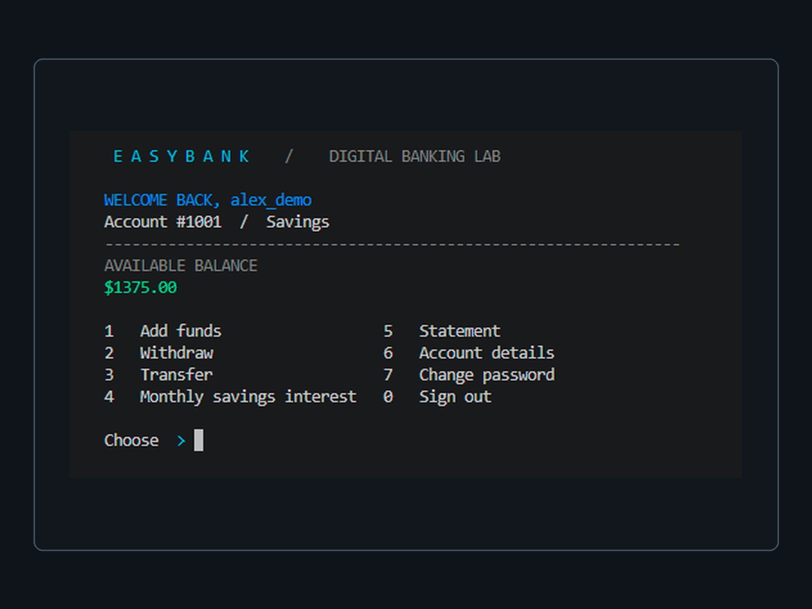
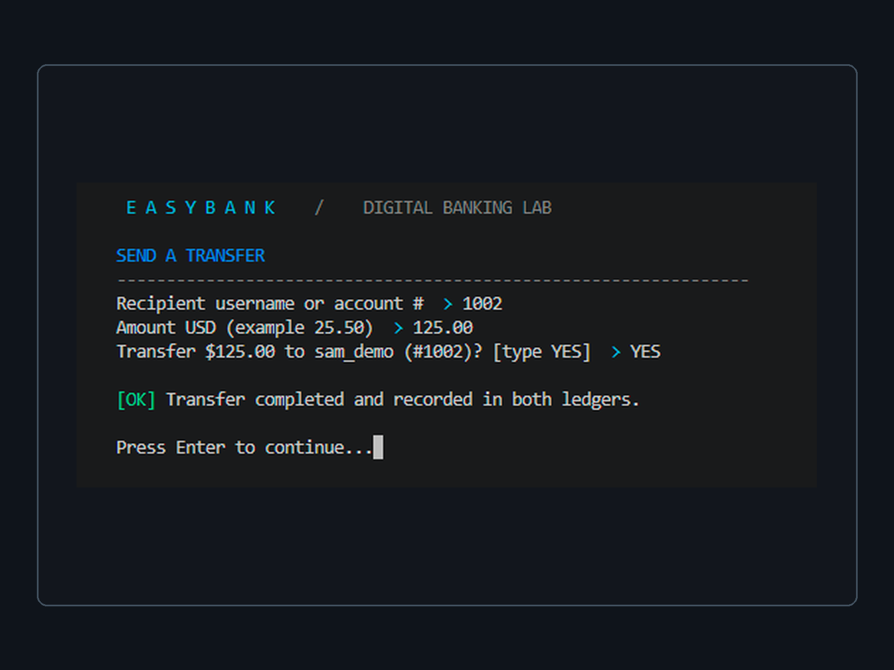
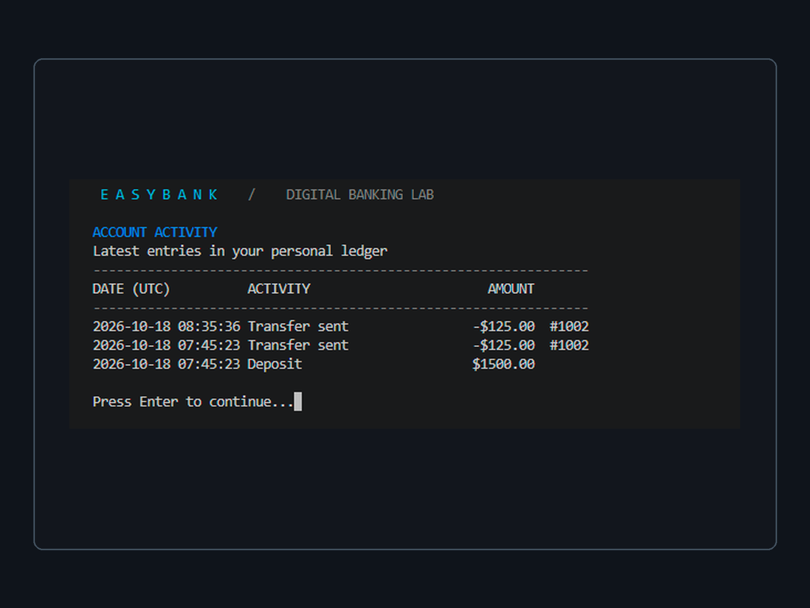

# EasyBank

**An offline banking-workflow simulator built in C++ and SQLite.**

EasyBank is a compact portfolio revision of an academic console-based banking project. It demonstrates account management, transactional integrity, secure password storage and a polished, color-accented terminal interface. All balances, accounts and transfers are fictional. **It is not a bank, payment product, or production-ready financial system.**

## What's included

- Create Savings or Checking accounts and sign in by username or account number
- View balances and account profiles, deposit, withdraw, and transfer funds
- Transaction statements ordered by ledger ID, including both sides of transfers
- Password change and a three-failed-attempt account lock
- Administrator dashboard, account freeze/restore, login unlock, and zero-balance closure
- Explicit 0.5% monthly Savings interest credit, limited to once per eligible month (never credited on balance views)
- Optional fictional demo data with three accounts and sample transactions
- SQLite atomic balance-and-ledger operations, integer-cent calculations, and parameterized queries
- Passwords salted and hashed with PBKDF2-HMAC-SHA256 (120,000 iterations)
- Portable C++17 source and bundled official SQLite amalgamation — no package manager or application server

## Run on Windows

Open `EasyBank_Portfolio` in VS Code. In the PowerShell terminal run:

```powershell
powershell -NoProfile -ExecutionPolicy Bypass -File .\Run-Local.ps1
```

The launcher uses the **existing Microsoft Visual C++ compiler** (from Visual Studio or Visual Studio Build Tools, with the Desktop C++ workload) to compile the bundled source. **No additional libraries, downloads, SDK installations or database server are performed by the script.** Windows does not ship a C++ compiler by default: if you don't already have one, the runner explains the missing prerequisite rather than downloading anything. Later launches reuse the compiled executable unless its source changed.

To compile and run only the self-test:

```powershell
powershell -NoProfile -ExecutionPolicy Bypass -File .\Run-Local.ps1 -TestOnly
```

Expected output: `EASYBANK_SELFTEST=PASS`.

### First launch

1. Set a local administrator password (at least 8 characters). Nothing is hardcoded.
2. Select **Administrator workspace** and sign in.
3. To explore the interface with activity, select **Load sample accounts** once, while the account database is empty.
4. Sign in to one of the fictional accounts.

| Demo username | Account | Password | Type |
|---|---|---|---|
| `alex_demo` | 1001 | `DemoPass123!` | Savings |
| `sam_demo` | 1002 | `DemoPass123!` | Checking |
| `jordan_demo` | 1003 | `DemoPass123!` | Savings |

Public demo passwords are deliberately weak as credentials for *real services*, despite being hashed in this educational app. They should never be reused.

## Where is data saved?

Windows: `%LOCALAPPDATA%\EasyBankPortfolio\bank.db`

To use an isolated testing location, set `EASYBANK_DATA_DIR` to another directory before launching. Your original uploaded `bank.db` is **not included, modified or migrated**. This release uses a new integer-cent schema; copying the old coursework database into the new location is **not supported**. Never place sensitive or real financial information in this app. Make a backup of `bank.db` before resetting the local demo.

## Architecture and limitations

One C++ source file, one SQLite amalgamation, and a small PowerShell runner. Account amounts are stored as integer cents. Each financial operation wraps its balance update(s) and ledger entries in a single SQLite transaction, rolling everything back on failure. Passwords are salted per account; verification uses constant-time comparison. Account closure retains ledger history and requires zero balance. Monthly interest is a simplified educational feature (not real banking interest calculation).

This is a **console interface**, not a native windowed GUI or website. The Windows console must support ANSI colors to show the accents; the app continues in plain text otherwise. It is offline and single-machine, with basic example roles, not banking-grade authentication, encryption-at-rest, fraud controls, multi-user authorization, or a real audit/compliance system.

## Developer validation

Linux with system OpenSSL + SQLite libraries installed:

```bash
g++ -std=c++17 -Wall -Wextra -O2 EasyBank.cpp -lsqlite3 -lcrypto -o easybank
./easybank --self-test
```

Windows local tests are run automatically by `Run-Local.ps1` after a successful MSVC build. Platform-specific CNG is used for PBKDF2 and secure random generation on Windows; OpenSSL is used only for optional Linux development/testing.

## Portfolio scope

Originally a small C++/SQLite classroom banking project, revised for safer money handling, reliable persistence, simpler navigation and a modern technical console presentation. Screenshots should be taken from the **real running application**; no fabricated application captures are provided. The original local database and Visual Studio caches are intentionally excluded.

<!-- EASYBANK_PORTFOLIO_GALLERY_BEGIN -->
## Application screenshots

Five **real captures** from the EasyBank C++17/SQLite terminal application, displayed on matching 1600 × 1200 canvases. Screens are taken from fictional local accounts and transactions; EasyBank is an educational offline simulation, not a real banking service.

### Main menu



### Administrator overview and account directory

Three fictional accounts with balances and ledger activity.



### Customer dashboard

Savings account, available balance, and account operations.



### Completed simulated transfer

An accepted $125.00 transfer from `alex_demo` to account `1002` (`sam_demo`).



### Account statement

The captured statement shows a $1,500 deposit and **two separate $125 transfers** at different timestamps. These represent recorded transactions, not duplicated screenshots.


<!-- EASYBANK_PORTFOLIO_GALLERY_END -->
